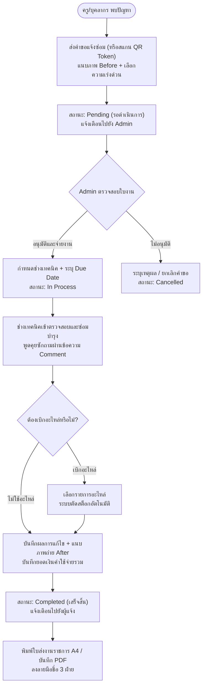
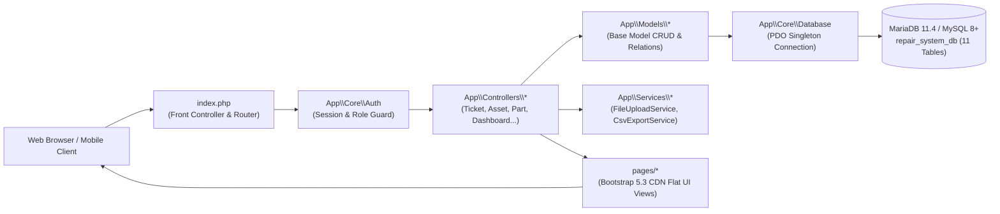
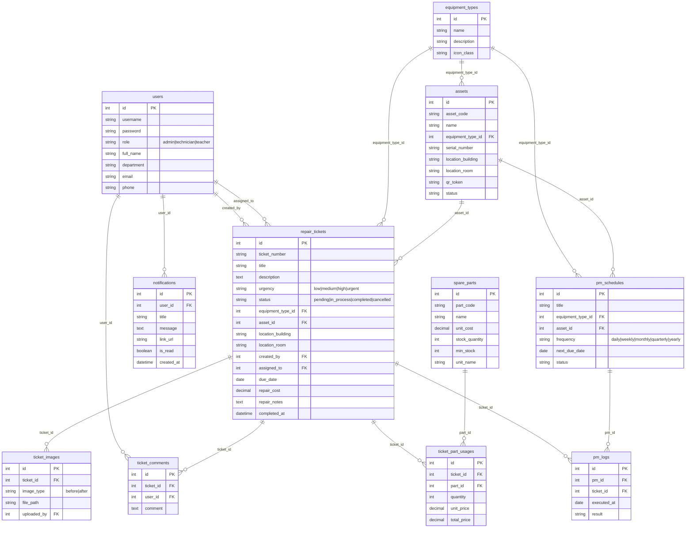

# RepairForSchool — ระบบบริหารจัดการงานแจ้งซ่อมบำรุงและครุภัณฑ์โรงเรียน

[](https://php.net/)
[](https://mariadb.org/)
[](https://getbootstrap.com/)
[](https://fontawesome.com/)
[](https://www.php-fig.org/psr/psr-4/)

ระบบบริหารจัดการงานแจ้งซ่อมบำรุงและครุภัณฑ์สำหรับสถานศึกษาและโรงเรียน พัฒนาด้วยสถาปัตยกรรม **PHP 8.3 OOP (PSR-4)** ร่วมกับฐานข้อมูลเชิงสัมพันธ์ **MariaDB 11.4 / MySQL** ออกแบบส่วนต่อประสานตามหลัก **Modern Flat Design** (Flat, Clean, Borderless Badges, ไร้การไล่เฉดสีรบกวนสายตา) พร้อมระบบจัดการสิทธิ์การเข้าถึง **Role-Based Access Control (RBAC 3 บทบาท)**, การติดตามสถานะแบบเรียลไทม์, คลังอะไหล่ตัดสต็อกอัตโนมัติ, การสแกนครุภัณฑ์ด้วย QR Token, แผนบำรุงรักษาเชิงป้องกัน (PM), และการพิมพ์ใบส่งงานราชการมาตรฐานขนาด A4

---

## 📑 สารบัญ (Table of Contents)

1. [🌟 ฟีเจอร์เด่นของระบบ (Core Features)](#-ฟีเจอร์เด่นของระบบ-core-features)
2. [🔑 บัญชีผู้ใช้งานสำหรับทดสอบ (Seed Accounts)](#-บัญชีผู้ใช้งานสำหรับทดสอบ-seed-accounts)
3. [🔄 ลำดับขั้นตอนการทำงาน (Workflow)](#-ลำดับขั้นตอนการทำงาน-workflow)
4. [🏛️ สถาปัตยกรรมระบบ (System Architecture)](#️-สถาปัตยกรรมระบบ-system-architecture)
5. [🗄️ โครงสร้างฐานข้อมูล 11 ตาราง (Database Schema & ERD)](#️-โครงสร้างฐานข้อมูล-11-ตาราง-database-schema--erd)
6. [🛡️ ตารางสิทธิ์ตามบทบาทผู้ใช้ (Role Permissions Matrix)](#️-ตารางสิทธิ์ตามบทบาทผู้ใช้-role-permissions-matrix)
7. [🚀 วิธีการติดตั้งและเปิดใช้งาน (Installation Guide)](#-วิธีการติดตั้งและเปิดใช้งาน-installation-guide)
8. [🧪 การทดสอบระบบอัตโนมัติ (Automated Test Suites)](#-การทดสอบระบบอัตโนมัติ-automated-test-suites)
9. [🌐 เส้นทาง URL ในระบบ (Route Map)](#-เส้นทาง-url-ในระบบ-route-map)
10. [📡 Real-Time Status API](#-real-time-status-api)
11. [📂 โครงสร้างไดเรกทอรี (Directory Structure)](#-โครงสร้างไดเรกทอรี-directory-structure)
12. [🎓 โครงการเพื่อการศึกษา (Educational Project)](#-โครงการเพื่อการศึกษา-educational-project)

---

## 🌟 ฟีเจอร์เด่นของระบบ (Core Features)

ระบบประกอบด้วย 8 โมดูลหลักที่ทำงานสอดประสานกันอย่างสมบูรณ์:

### 1. 🔐 ระบบสิทธิ์ 3 บทบาท (Role-Based Access Control)
- **ผู้ดูแลระบบ (Admin):** มองเห็นภาพรวมทั้งระบบ, มอบหมายงานช่าง, กำหนดวันนัดหมายแล้วเสร็จ (Due Date), จัดการหมวดหมู่อุปกรณ์, ดูแลคลังอะไหล่, จัดการบัญชีผู้ใช้, และส่งออกรายงาน
- **ช่างเทคนิค (Technician):** ตรวจสอบงานที่ได้รับมอบหมาย, รายงานความคืบหน้า, บันทึกการเบิกอะไหล่ตัดสต็อก, แนบภาพถ่ายหลังซ่อม (After), และพิมพ์ใบสั่งงาน
- **ครูและบุคลากร (Teacher / Staff):** ส่งคำขอแจ้งซ่อม, สแกน QR Token อุปกรณ์เพื่อกรอกข้อมูลอัตโนมัติ, แนบภาพปัญหา (Before), ติดตามสถานะ, และสอบถามผ่านกระดานข้อความ
- มีระบบ **Session Guard** ตรวจสอบสิทธิ์ทุกคำขอ ป้องกันการเข้าถึงข้ามสิทธิ์โดยไม่ได้รับอนุญาต

### 2. 📝 ระบบจัดการงานแจ้งซ่อมแบบครบวงจร (Ticket Lifecycle)
- ระบบสร้างรหัสอ้างอิงอัตโนมัติมาตรฐาน `REP-YYYYMM-XXXX` (เช่น `REP-202609-0001`)
- ตัวกรองสถานะ 4 ขั้น: **รอดำเนินการ (Pending)**, **กำลังดำเนินการ (In Process)**, **ซ่อมเสร็จสิ้น (Completed)**, และ **ยกเลิก (Cancelled)**
- เลือกระดับความเร่งด่วน: ต่ำ (Low), ปานกลาง (Medium), สูง (High), และ **ฉุกเฉินเร่งด่วน (Urgent)**
- มีป้ายแจ้งเตือนเมื่อเลยกำหนดวันนัดหมาย (**Overdue Badge**)
- รองรับการแนบภาพถ่ายหลักฐาน 2 ช่วง: **ภาพก่อนซ่อม (Before)** จากผู้แจ้ง และ **ภาพหลังซ่อมเสร็จ (After)** จากช่าง
- ระบบบันทึกประวัติการเปลี่ยนสถานะ (**Status Timeline Logs**) ตรวจสอบย้อนหลังได้ทุกการกระทำ

### 3. 🏷️ ระบบทะเบียนครุภัณฑ์และสแกน QR Code (Asset Registry & QR Token)
- บันทึกรหัสครุภัณฑ์ (Asset Code), เลขทะเบียนราชการ/ซีเรียล (Serial Number), สถานที่ติดตั้ง, และสถานะการใช้งาน
- สร้างรหัสความปลอดภัย **QR Token** สำหรับสร้างลิงก์หรือพิมพ์สติกเกอร์ติดที่ตัวเครื่อง
- **Auto-Fill เมื่อสแกน QR Code:** เมื่อสแกน QR Code จากโทรศัพท์มือถือ ระบบจะเปิดหน้าแจ้งซ่อมพร้อมดึงชื่ออุปกรณ์ อาคาร ห้องเรียน และประเภทงานซ่อมให้อัตโนมัติทันที ผู้แจ้งพิมพ์เพียงอาการที่พบ

### 4. 📦 ระบบคลังอะไหล่และตัดสต็อกอัตโนมัติ (Spare Parts Inventory)
- บันทึกรหัสอะไหล่, ชื่ออะไหล่, ราคาต่อหน่วย, จำนวนสต็อกคงเหลือ, และจุดเตือนสั่งซื้อขั้นต่ำ (**Min Stock Threshold**)
- เมื่อช่างทำการอัพเดทผลการซ่อม สามารถเลือกอะไหล่ที่ใช้และระบุจำนวน -> ระบบจะทำ **Atomic Transaction** เพื่อตัดยอดคงคลังอัตโนมัติ
- คำนวณยอดเงินค่าอะไหล่รวมกับค่าใช้จ่ายอื่น ๆ เพื่อสรุปเป็น **ยอดค่าใช้จ่ายการซ่อมบำรุงจริง (Total Repair Cost)**

### 5. 🗓️ ระบบแผนการบำรุงรักษาเชิงป้องกัน (Preventive Maintenance - PM)
- กำหนดรอบการตรวจเช็คอุปกรณ์ประจำงวด: รายวัน (Daily), รายสัปดาห์ (Weekly), รายเดือน (Monthly), รายไตรมาส (Quarterly), รายครึ่งปี (Semi-Annually), และรายปี (Yearly)
- คำนวณวันครบกำหนดรอบถัดไป (**Next Due Date**) ให้อัตโนมัติ
- ปุ่ม **Generate Ticket** แปลงแผนตรวจบำรุงรักษาเป็นใบสั่งงานจริงให้ช่างเทคนิคดำเนินการได้ทันทีเพียงคลิกเดียว

### 6. 🔔 ศูนย์แจ้งเตือนภายในระบบ (In-App Notification Center)
- ไอคอนกระดิ่งพร้อมป้ายตัวเลขแจ้งเตือนแบบเรียลไทม์ (**Unread Badge**) บนแถบเมนูนำทาง
- แจ้งเตือนเมื่อ: มีใบแจ้งซ่อมใหม่, ได้รับมอบหมายงาน, มีการตอบความคิดเห็นในใบงาน, หรืออะไหล่ใกล้หมดสต็อก
- หน้าศูนย์แจ้งเตือนรวม พร้อมปุ่ม **"ทำเครื่องหมายว่าอ่านแล้วทั้งหมด" (Mark All as Read)** และลิงก์ไปยังใบงานที่เกี่ยวข้องโดยตรง

### 7. 📊 แดชบอร์ดสถิติ KPI และส่งออกรายงาน Excel (KPI & CSV Export)
- สรุปตัวเลขดัชนีชี้วัดสถานะงานซ่อม: ทั้งหมด, รอดำเนินการ, กำลังซ่อม, ซ่อมเสร็จ, และงานค้างเกินกำหนด
- กราฟแสดงสัดส่วนงานซ่อมตามหมวดหมู่อุปกรณ์
- ตารางตรวจสอบภาระงานของช่างเทคนิคแต่ละท่าน (**Technician Workload Analysis**)
- ส่งออกรายงานเป็นไฟล์ **CSV พร้อม UTF-8 BOM** รองรับการเปิดด้วย Microsoft Excel โดยตัวอักษรภาษาไทยไม่แสดงผลผิดเพี้ยน

### 8. 🖨️ พิมพ์ใบส่งงานมาตรฐาน A4 / เอกสารทางการ PDF
- แบบฟอร์มใบแจ้งซ่อมและรายงานผลการซ่อมมาตรฐานขนาด A4
- จัดสัดส่วนคมชัด พร้อมแสดงข้อมูลรายละเอียด, ภาพหลักฐาน Before/After, และรายการอะไหล่ที่ใช้
- มีบล็อกลงนามเป็นลายลักษณ์อักษร 3 ฝ่าย: **ผู้แจ้งซ่อม / ครู**, **ช่างเทคนิคผู้ปฏิบัติงาน**, และ **หัวหน้างาน/ผู้บริหารสถานศึกษา**

---

## 🔑 บัญชีผู้ใช้งานสำหรับทดสอบ (Seed Accounts)

ระบบมาพร้อมข้อมูลตั้งต้นและบัญชีทดสอบครบทุกบทบาท โดยทุกบัญชีใช้รหัสผ่านเดียวกัน: `password123`

| ชื่อผู้ใช้งาน (Username) | รหัสผ่าน (Password) | บทบาท (Role) | ชื่อ-นามสกุล | ตำแหน่ง / แผนก |
| :--- | :--- | :--- | :--- | :--- |
| `admin` | `password123` | **Admin** | อ.สมเกียรติ บริหารงาน | ฝ่ายบริหารงานทั่วไปและอาคารสถานที่ |
| `tech01` | `password123` | **Technician** | ช่างสมชาย มั่นคง | ช่างเทคนิคอาวุโส / งานระบบไฟฟ้าและปรับอากาศ |
| `tech02` | `password123` | **Technician** | ช่างวิชัย ว่องไว | ช่างซ่อมบำรุง / ระบบคอมพิวเตอร์และเครือข่าย |
| `teacher01` | `password123` | **Teacher** | ครูสุดา วงศ์ไทย | หัวหน้ากลุ่มสาระวิทยาศาสตร์และเทคโนโลยี |
| `teacher02` | `password123` | **Teacher** | ครูอนุชา กิตติสุข | อาจารย์ประจำกลุ่มสาระคณิตศาสตร์ |
| `staff01` | `password123` | **Teacher / Staff** | นางวิภา อมรศิลป์ | เจ้าหน้าที่ธุรการและการเงิน |

> 💡 **ฟีเจอร์ 1-Click Test Login:** ที่หน้าเข้าสู่ระบบ (`index.php?page=login`) มีปุ่มกดสลับบทบาทเป็น Admin, Technician หรือ Teacher ได้ทันทีในคลิกเดียวโดยไม่ต้องพิมพ์รหัสผ่าน เหมาะสำหรับการสาธิตและการนำเสนอผลงาน

---

## 🔄 ลำดับขั้นตอนการทำงาน (Workflow)



---

## 🏛️ สถาปัตยกรรมระบบ (System Architecture)

ระบบถูกออกแบบภายใต้หลักการ **Object-Oriented Programming (OOP)**, **Single Responsibility**, และ **MVC Pattern** โดยไม่พึ่งพา Framework ขนาดใหญ่ เพื่อให้โค้ดทำงานได้อย่างรวดเร็วและบำรุงรักษาง่าย



### การจัดเลเยอร์โค้ด (Layer Separation):
- **Front Controller (`index.php`):** จุดเข้าสู่ระบบจุดเดียว (Single Entry Point) จัดการ Clean Routing, สลับหน้า, และส่งต่อ Request
- **Core Engine (`src/Core/`):**
  - `Database.php`: จัดการ Connection PDO ในรูปแบบ Singleton, ควบคุม Transaction, และมีตัวอ่าน `.env` ในตัว
  - `Auth.php`: ระบบยืนยันตัวตน, จัดการ Session Guard, และ Role-based Access Control
  - `Model.php`: แม่แบบ Active Record / Data Mapper รองรับคำสั่ง CRUD, Pagination, และการ Query อย่างปลอดภัย
  - `Controller.php`: แม่แบบ Controller ควบคุมการ Render View, ส่งผ่านตัวแปร, และจัดการ Flash Session Message
  - `Session.php`: จัดการ Session อย่างปลอดภัย ป้องกัน Session Fixation
  - `Response.php`: ยูทิลิตี้จัดการ Response เช่น JSON API และ HTTP Redirects
- **Service Layer (`src/Services/`):**
  - `FileUploadService.php`: ตรวจสอบประเภทไฟล์รูปภาพ (MIME Type), สุ่มชื่อไฟล์กันการซ้ำซ้อน, บันทึกรูป Before/After
  - `CsvExportService.php`: สร้างไฟล์ CSV และใส่ไบต์ **UTF-8 BOM (`\xEF\xBB\xBF`)** สำหรับเปิดใน Microsoft Excel ภาษาไทยไม่เพี้ยน

---

## 🗄️ โครงสร้างฐานข้อมูล 11 ตาราง (Database Schema & ERD)

ระบบใช้โครงสร้างฐานข้อมูลเชิงสัมพันธ์ **11 ตาราง** พร้อม Foreign Key Constraints และ Index เพื่อความถูกต้องของข้อมูล (Data Integrity):



---

## 🛡️ ตารางสิทธิ์ตามบทบาทผู้ใช้ (Role Permissions Matrix)

| หน้าที่การทำงาน / Route | ผู้ดูแลระบบ (Admin) | ช่างเทคนิค (Technician) | ครู / บุคลากร (Teacher) |
| :--- | :---: | :---: | :---: |
| เข้าสู่ระบบ / สลับบัญชีทดสอบ | ✅ | ✅ | ✅ |
| ดูแดชบอร์ดเฉพาะบทบาท | ✅ (Admin KPI) | ✅ (Tech Workload) | ✅ (Teacher Tickets) |
| ส่งคำขอแจ้งซ่อม (Create Ticket) | ✅ | ✅ | ✅ |
| สแกน QR Token อุปกรณ์แจ้งซ่อม | ✅ | ✅ | ✅ |
| มอบหมายงานช่าง & กำหนด Due Date | ✅ | ❌ | ❌ |
| เปลี่ยนสถานะงาน & บันทึกผลการซ่อม | ✅ | ✅ | ❌ |
| บันทึกการเบิกอะไหล่ตัดสต็อก | ✅ | ✅ | ❌ |
| แนบรูปภาพก่อนซ่อม (Before) | ✅ | ✅ | ✅ |
| แนบรูปภาพหลังซ่อม (After) | ✅ | ✅ | ❌ |
| เขียนข้อความในกระทู้ Comment | ✅ | ✅ | ✅ |
| พิมพ์ใบสั่งงานขนาด A4 / PDF | ✅ | ✅ | ✅ |
| ส่งออกรายงานสถิติเป็น CSV/Excel | ✅ | ❌ | ❌ |
| จัดการทะเบียนครุภัณฑ์ (Assets) | ✅ | ดูรายการ | ดูรายการ |
| จัดการคลังอะไหล่ (Spare Parts) | ✅ | ดูสต็อก/เบิกใช้ | ❌ |
| จัดการแผนบำรุงรักษาเชิงป้องกัน (PM) | ✅ | ✅ | ❌ |
| จัดการหมวดหมู่อุปกรณ์ (Equipment Types) | ✅ | ❌ | ❌ |
| จัดการบัญชีผู้ใช้งาน (User Management) | ✅ | ❌ | ❌ |
| แก้ไขข้อมูลส่วนตัว & เปลี่ยนรหัสผ่าน | ✅ | ✅ | ✅ |
| ดูศูนย์แจ้งเตือนภายใน (Notifications) | ✅ | ✅ | ✅ |

---

## 🚀 วิธีการติดตั้งและเปิดใช้งาน (Installation Guide)

### ความต้องการของระบบ (Prerequisites)
- **PHP:** เวอร์ชั่น 8.2 หรือ 8.3 ขึ้นไป พร้อมเปิดใช้งานส่วนขยาย `pdo`, `pdo_mysql`, `mbstring`
- **ฐานข้อมูล:** MariaDB 10.4+ หรือ MySQL 8.0+
- **เว็บเซิร์ฟเวอร์:** Apache (เปิดใช้งาน `mod_rewrite`) หรือ Nginx หรือ PHP Built-in Server

---

### ขั้นตอนการติดตั้งทีละสเต็ป (Step-by-Step)

#### 1. ดาวน์โหลดหรือโคลนโปรเจกต์
```bash
git clone https://github.com/jirathxz/RepairForSchool.git
cd RepairForSchool
```

#### 2. นำเข้าฐานข้อมูล (Import Database)
1. เปิด phpMyAdmin หรือ MariaDB/MySQL CLI
2. สร้างฐานข้อมูลใหม่ชื่อ: `repair_system_db`
   ```sql
   CREATE DATABASE repair_system_db CHARACTER SET utf8mb4 COLLATE utf8mb4_unicode_ci;
   ```
3. นำเข้าไฟล์ `database.sql` ในโปรเจกต์เข้าสู่ฐานข้อมูล `repair_system_db`:
   ```bash
   mysql -u root -p repair_system_db < database.sql
   ```

#### 3. ตั้งค่าสภาพแวดล้อม (Environment Configuration)
คัดลอกไฟล์ `.env.example` ไปเป็น `.env` และแก้ไขค่าการเชื่อมต่อฐานข้อมูลให้ตรงกับเครื่องของคุณ:
```bash
cp .env.example .env
```
ตรวจสอบและแก้ไขเนื้อหาในไฟล์ `.env`:
```ini
APP_NAME="Repair System Class"
APP_ENV=development
APP_DEBUG=true
APP_URL=http://localhost:8090

DB_HOST=127.0.0.1
DB_PORT=3306
DB_DATABASE=repair_system_db
DB_USERNAME=root
DB_PASSWORD=
DB_CHARSET=utf8mb4
```

#### 4. เริ่มต้นเซิร์ฟเวอร์ (Starting the Application)

##### วิธีที่ 1: รันด้วย Windows 1-Click Script (แนะนำสำหรับสภาพแวดล้อม XAMPP/MariaDB ในโปรเจกต์)
ดับเบิลคลิกไฟล์ `run.bat` หรือรันผ่าน Command Prompt:
```cmd
run.bat
```
- สคริปต์จะเริ่มทำงานบริการ MariaDB (Port `3306`) และ Apache (Port `8090`) โดยอัตโนมัติ
- เปิดเบราว์เซอร์ไปยัง `http://localhost:8090` และ phpMyAdmin `http://localhost:8090/phpmyadmin`
- เมื่อต้องการรีสตาร์ทเซิร์ฟเวอร์ ให้ดับเบิลคลิก `restart.bat`
- เมื่อต้องการปิดเซิร์ฟเวอร์ ให้ดับเบิลคลิก `stop.bat`

##### วิธีที่ 2: รันด้วย PHP Built-in Web Server (สำหรับนักพัฒนาทั่วไป)
```bash
php -S localhost:8090
```
จากนั้นเปิดเว็บเบราว์เซอร์ไปที่: **`http://localhost:8090`**

---

## 🧪 การทดสอบระบบอัตโนมัติ (Automated Test Suites)

โปรเจกต์มาพร้อมชุดทดสอบ Smoke Test อัตโนมัติในตัว ครอบคลุมการทำงานทุกส่วน เพื่อรับประกันความเสถียรของฐานข้อมูล, Model CRUD, สิทธิ์ผู้ใช้งาน, และความถูกต้องของ Business Logic

### รันชุดทดสอบระบบหลัก (16 Test Suites):
```bash
php test_system.php
```
ผลการทดสอบ:
```text
====================================================
 RepairForSchool - Unified OOP Smoke & System Test
====================================================
1. Database Status      : connected (Version: 11.4.0-MariaDB, Tables: 16)
2. Admin Login          : PASS (อ.สมเกียรติ บริหารงาน (ผู้ดูแลระบบ), Role: admin)
3. Tech Login           : PASS (ช่างสมชาย มั่นคง (ช่างเทคนิค/ไฟฟ้า), Role: technician)
4. Teacher Login        : PASS (ครูสุดา วงศ์ไทย, Role: teacher)
5. User Profile Check   : PASS (ID: 1, admin@school.ac.th)
6. KPI Status Counts    : Total=8, Pending=2, InProcess=3, Completed=3
7. Overdue Tickets      : 3 tickets
8. Equipment Types CRUD : 8 types loaded with stats
   - First type canDelete: NO (in use)
9. Ticket #1 Detail     : [REP-202609-0001] คอมพิวเตอร์ห้องปฏิบัติการเปิดไม่ติด
   - Location           : อาคาร 2 (วิทยาศาสตร์) (ห้องปฏิบัติการคอมพิวเตอร์ 204)
   - Status             : in_process
10. Status Timeline     : 2 timeline log events loaded
11. Comments Thread     : 3 comments on Ticket #1
12. Tech Workloads      : 2 technicians assigned
13. Asset Registry      : 5 school assets registered
    - QR Token Match    : [ศธ-0401/65-005] -> ASSET-TOKEN-005 (PASS)
14. Spare Parts Stock   : 6 parts in inventory
15. PM Schedules        : 3 schedules configured
16. In-App Notifications: PASS (Created #9, unread=1, markAsRead=OK)
====================================================
 ALL 16 TEST SUITES EXECUTED & PASSED PERFECTLY!
====================================================
```

### รันชุดทดสอบระบบย่อยใหม่ (New Systems Verification):
```bash
php test_new_systems.php
```

---

## 🌐 เส้นทาง URL ในระบบ (Route Map)

| เส้นทาง (Route) | เมธอด (Method) | สิทธิ์ที่เข้าถึงได้ | หน้าที่การทำงาน |
| :--- | :---: | :--- | :--- |
| `index.php?page=landing` | GET | ทุกคน | หน้าแรก Landing Page แสดงสถานะและปุ่มเข้าสู่ระบบ |
| `index.php?page=login` | GET / POST | ทุกคน | หน้าฟอร์มล็อกอิน และปุ่ม 1-Click Test Login |
| `index.php?page=logout` | GET | ทุกคนที่ล็อกอิน | เคลียร์ Session และออกจากระบบอย่างปลอดภัย |
| `index.php?page=admin-dashboard` | GET | **Admin** | แดชบอร์ดสรุปสถิติ KPI, กราฟ, และภาระงานช่าง |
| `index.php?page=technician-dashboard` | GET | **Technician** | แดชบอร์ดงานซ่อมในมือของช่างเทคนิค |
| `index.php?page=teacher-dashboard` | GET | **Teacher** | ประวัติคำขอแจ้งซ่อมของครู และปุ่มส่งคำขอแจ้งซ่อมด่วน |
| `index.php?page=tickets` | GET | ทุกคน (ตามสิทธิ์) | หน้ารวมใบแจ้งซ่อม พร้อมตัวกรองค้นหาละเอียด |
| `index.php?page=tickets-create` | GET / POST | ทุกคน | แบบฟอร์มแจ้งซ่อม แนบภาพ Before และรับ QR Token |
| `index.php?page=tickets-show&id={id}` | GET | ทุกคน (ตามสิทธิ์) | หน้ารายละเอียดใบซ่อม, แชทความคิดเห็น, อัพเดทผล |
| `index.php?page=tickets-assign` | POST | **Admin** | จ่ายงานให้ช่างเทคนิค และกำหนด Due Date |
| `index.php?page=tickets-update-status` | POST | **Admin / Tech** | เปลี่ยนสถานะงาน, บันทึกการเบิกอะไหล่, แนบภาพ After |
| `index.php?page=tickets-comment` | POST | ทุกคนที่ล็อกอิน | โพสต์ความคิดเห็น/ข้อความตอบกลับในใบแจ้งซ่อม |
| `index.php?page=tickets-export` | GET | **Admin** | ดาวน์โหลดไฟล์รายงานสรุปงานซ่อมเป็น CSV (Excel BOM) |
| `index.php?page=tickets-print&id={id}` | GET | ทุกคน | พิมพ์ใบแจ้งซ่อมและรายงานผลมาตรฐานขนาด A4 / PDF |
| `index.php?page=assets` | GET | ทุกคน (ตามสิทธิ์) | รายการทะเบียนครุภัณฑ์ของโรงเรียน |
| `index.php?page=assets-create` | GET / POST | **Admin** | แบบฟอร์มเพิ่มครุภัณฑ์ใหม่และสร้าง QR Token |
| `index.php?page=assets-edit&id={id}` | GET / POST | **Admin** | แก้ไขข้อมูลครุภัณฑ์และสถานที่ติดตั้ง |
| `index.php?page=assets-qr&id={id}` | GET | ทุกคน | หน้าแสดงและพิมพ์สติกเกอร์ QR Code ของครุภัณฑ์ |
| `index.php?page=parts` | GET | **Admin / Tech** | ตรวจสอบสต็อกอะไหล่และอุปกรณ์สำรอง |
| `index.php?page=parts-create` | GET / POST | **Admin** | เพิ่มรายการอะไหล่ กำหนดราคาต่อหน่วยและสต็อกขั้นต่ำ |
| `index.php?page=parts-edit&id={id}` | GET / POST | **Admin** | แก้ไขข้อมูลอะไหล่และปรับยอดสต็อก |
| `index.php?page=pm-schedules` | GET | **Admin / Tech** | รายการแผนบำรุงรักษาเชิงป้องกันประจำรอบเวลา |
| `index.php?page=pm-schedules-create` | GET / POST | **Admin** | เพิ่มแผนการตรวจเช็คและระบุความถี่ |
| `index.php?page=pm-schedules-generate` | POST | **Admin** | แปลงแผน PM เป็นใบสั่งงานซ่อมจริงในระบบ |
| `index.php?page=equipment-types` | GET | **Admin** | รายการหมวดหมู่อุปกรณ์ พร้อมสถิติจำนวนงานซ่อม |
| `index.php?page=equipment-types-create` | GET / POST | **Admin** | เพิ่มหมวดหมู่อุปกรณ์และเลือกไอคอน Font Awesome |
| `index.php?page=equipment-types-edit&id={id}` | GET / POST | **Admin** | แก้ไขชื่อหมวดหมู่และคำอธิบาย |
| `index.php?page=equipment-types-delete` | POST | **Admin** | ลบหมวดหมู่ (ระบบจะปฏิเสธหากยังมีใบซ่อมผูกอยู่) |
| `index.php?page=notifications` | GET | ทุกคนที่ล็อกอิน | ศูนย์รวมรายการแจ้งเตือนทั้งหมดของผู้ใช้ |
| `index.php?page=notifications-read-all` | POST | ทุกคนที่ล็อกอิน | ทำเครื่องหมายว่าอ่านแล้วทุกข้อความแจ้งเตือน |
| `index.php?page=profile` | GET / POST | ทุกคนที่ล็อกอิน | แก้ไขข้อมูลส่วนตัว, เบอร์โทรศัพท์, และเปลี่ยนรหัสผ่าน |
| `index.php?page=users` | GET | **Admin** | รายชื่อผู้ใช้งานทั้งหมด และสถิติการใช้งาน |
| `index.php?page=users-create` | GET / POST | **Admin** | สร้างบัญชีผู้ใช้งานใหม่ กำหนดบทบาทและแผนก |

---

## 📡 Real-Time Status API

ระบบมี REST API Endpoint สำหรับตรวจสอบสถานะสุขภาพของระบบและสถิติแบบสด:

### `GET /api/status.php`

**ตัวอย่างการเรียกใช้งาน (Response):**
```json
{
  "status": "online",
  "database": {
    "status": "connected",
    "version": "11.4.0-MariaDB",
    "tables_count": 16
  },
  "kpi": {
    "total": 8,
    "pending": 2,
    "in_process": 3,
    "completed": 3,
    "overdue": 3
  },
  "notifications": {
    "unread_count": 1
  },
  "server_time": "2026-10-22 15:00:00"
}
```

---

## 📂 โครงสร้างไดเรกทอรี (Directory Structure)

```text
d:\_Work\RepairSystemClass/
├── index.php                         # Front Controller และระบบ Router กลาง
├── composer.json                     # กำหนดค่า PSR-4 Autoloading มาตรฐาน
├── database.sql                      # ฐานข้อมูล Schema 11 ตาราง พร้อม Seed ข้อมูล
├── database_migration_new_systems.sql # สคริปต์ Migration ระบบเพิ่มเติม
├── test_system.php                   # ชุดทดสอบระบบหลัก 16 หมวดหมู่ (Smoke Tests)
├── test_new_systems.php              # ชุดทดสอบระบบย่อยใหม่ (Assets, PM, Stock, Notify)
├── run.bat                           # สคริปต์ 1-Click เปิดเซิร์ฟเวอร์ Apache + MariaDB
├── restart.bat                       # สคริปต์รีสตาร์ทเซิร์ฟเวอร์
├── stop.bat                          # สคริปต์หยุดการทำงานของเซิร์ฟเวอร์
├── mysql_cli.bat                     # สคริปต์เปิด MariaDB / MySQL Terminal CLI
├── .env.example                      # ตัวอย่างการตั้งค่าสภาพแวดล้อม
├── .env                              # การตั้งค่าคอนฟิกจริง (Local Environment)
├── .gitignore                        # กรองไฟล์ที่ไม่ต้องการให้ขึ้น Git Repository
│
├── src/                              # ซอร์สโค้ด PHP OOP ตามมาตรฐาน PSR-4 (Namespace App\)
│   ├── Core/
│   │   ├── Auth.php                  # ระบบตรวจสอบสิทธิ์, Session Guard, Role Permissions
│   │   ├── Controller.php            # Base Controller จัดการ View, Data และ Flash Message
│   │   ├── Database.php              # PDO Singleton Connection, Transactions, .env Loader
│   │   ├── Model.php                 # Active Record / Data Mapper Base Model พร้อม CRUD
│   │   ├── Response.php              # HTTP Responses (JSON API, Redirects)
│   │   └── Session.php               # ระบบจัดการ Session และ Flash Notifications
│   ├── Models/
│   │   ├── User.php                  # โมเดลบัญชีผู้ใช้งานและการยืนยันตัวตน
│   │   ├── RepairTicket.php          # โมเดลใบแจ้งซ่อม, คำนวณ KPI, กรองข้อมูล
│   │   ├── EquipmentType.php         # หมวดหมู่อุปกรณ์และงานซ่อมบำรุง
│   │   ├── Asset.php                 # โมเดลทะเบียนครุภัณฑ์และ QR Token
│   │   ├── SparePart.php             # โมเดลคลังอะไหล่และคำนวณจุดสั่งซื้อ
│   │   ├── TicketPartUsage.php       # โมเดลบันทึกการเบิกอะไหล่และตัดสต็อก
│   │   ├── TicketImage.php           # โมเดลรูปภาพหลักฐานก่อน-หลังซ่อม
│   │   ├── TicketComment.php         # โมเดลความคิดเห็นและข้อความซักถาม
│   │   ├── PMSchedule.php            # โมเดลแผนการบำรุงรักษาเชิงป้องกัน
│   │   └── Notification.php          # โมเดลการแจ้งเตือนภายในระบบ
│   ├── Controllers/
│   │   ├── AuthController.php        # เข้าสู่ระบบ, 1-Click Login, ออกจากระบบ
│   │   ├── DashboardController.php   # แสดงแดชบอร์ดตามบทบาท (Admin/Tech/Teacher)
│   │   ├── TicketController.php      # จัดการใบแจ้งซ่อม, มอบหมายงาน, พิมพ์ A4, ส่งออก CSV
│   │   ├── AssetController.php       # จัดการครุภัณฑ์และการแสดง QR Code
│   │   ├── SparePartController.php   # จัดการคลังอะไหล่และรายงานสต็อก
│   │   ├── PMScheduleController.php  # จัดการแผนบำรุงรักษาเชิงป้องกัน
│   │   ├── EquipmentTypeController.php # จัดการหมวดหมู่อุปกรณ์ (CRUD)
│   │   ├── NotificationController.php# ศูนย์รวมการแจ้งเตือนและการอ่านข้อความ
│   │   ├── CommentController.php     # โพสต์ข้อความสอบถามในใบแจ้งซ่อม
│   │   ├── UserController.php        # แอดมินจัดการบัญชีผู้ใช้งาน
│   │   └── LandingController.php     # หน้าแรกของระบบ (Landing Page)
│   └── Services/
│       ├── FileUploadService.php     # บริการตรวจสอบและอัพโหลดไฟล์รูปภาพ Before/After
│       └── CsvExportService.php      # บริการส่งออก CSV พร้อม UTF-8 BOM สำหรับ Excel
│
├── pages/                            # วิวและเทมเพลตส่วนต่อประสาน (Modern Flat UI)
│   ├── layout/
│   │   ├── header.php                # เมนูนำทางแบบจัดกลุ่ม Dropdown, ระฆังแจ้งเตือน, เมนูผู้ใช้
│   │   └── footer.php                # ส่วนท้ายเว็บ สคริปต์ Bootstrap CDN และ Toast แจ้งเตือน
│   ├── auth/                         # หน้าแบบฟอร์มล็อกอิน และปุ่ม Quick Test
│   ├── admin/                        # แดชบอร์ดสรุปสถิติ KPI, กราฟ, จัดการผู้ใช้
│   ├── technician/                   # แดชบอร์ดงานซ่อมและภาระงานของช่างเทคนิค
│   ├── teacher/                      # แดชบอร์ดประวัติการแจ้งซ่อมของครู
│   ├── tickets/                      # ตารางค้นหา, ฟอร์มส่งคำขอ, และหน้ารายละเอียดใบซ่อม
│   ├── assets/                       # รายการครุภัณฑ์, ฟอร์มเพิ่ม/แก้ไข, หน้าสติกเกอร์ QR Code
│   ├── parts/                        # รายการคลังอะไหล่, ฟอร์มเพิ่ม/แก้ไขสต็อก
│   ├── pm/                           # รายการแผนบำรุงรักษาเชิงป้องกัน (PM)
│   ├── equipment_types/              # รายการหมวดหมู่อุปกรณ์ (CRUD)
│   ├── notifications/                # หน้ารวมประวัติการแจ้งเตือนทั้งหมด
│   ├── profile/                      # หน้าแก้ไขข้อมูลส่วนตัวและเปลี่ยนรหัสผ่าน
│   └── shared/                       # แบบฟอร์มพิมพ์เอกสารราชการขนาด A4 / บันทึก PDF
│
├── api/
│   └── status.php                    # REST API สรุปสถานะสุขภาพระบบและจำนวนงานแบบเรียลไทม์
├── assets/
│   ├── css/app.css                   # Custom CSS tokens, Flat UI rules, และ Print A4 CSS
│   └── js/app.js                     # สคริปต์ Interaction, พรีวิวรูปภาพ, ยืนยันการลบ
└── uploads/
    ├── before/                       # โฟลเดอร์เก็บรูปภาพปัญหาถ่ายก่อนซ่อม
    └── after/                        # โฟลเดอร์เก็บรูปภาพหลักฐานผลการซ่อมเสร็จ
```

---

## 🎓 โครงการเพื่อการศึกษา (Educational Project)

โครงงานระบบบริหารจัดการงานแจ้งซ่อมบำรุงและครุภัณฑ์โรงเรียน (RepairForSchool) จัดทำขึ้นเพื่อวัตถุประสงค์ในการศึกษา การค้นคว้า และการเรียนรู้การออกแบบสถาปัตยกรรมซอฟต์แวร์เชิงวัตถุ (Object-Oriented Programming & Software Design Patterns) ในรายวิชาการพัฒนาเว็บแอปพลิเคชัน

